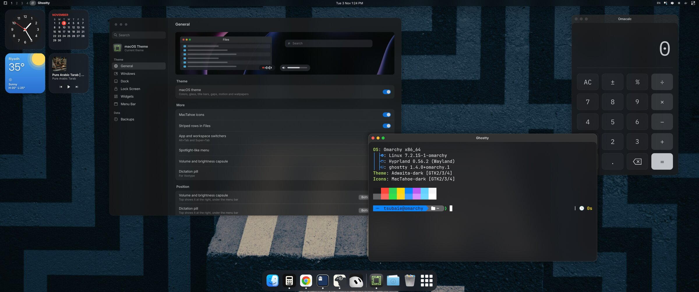
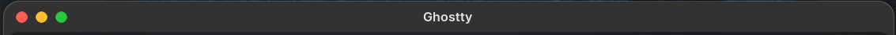
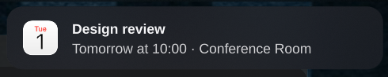
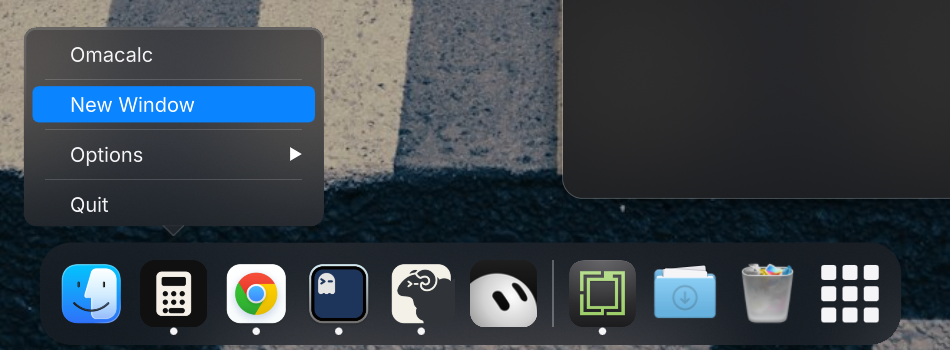
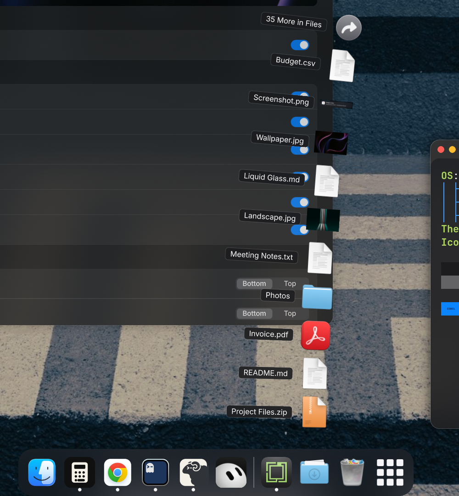
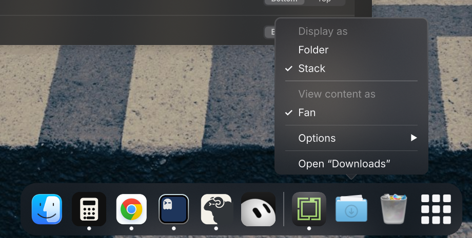
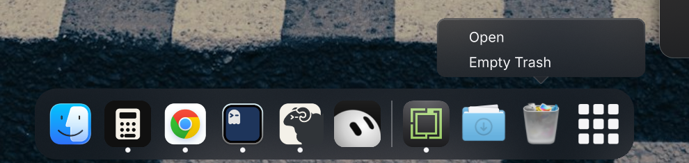
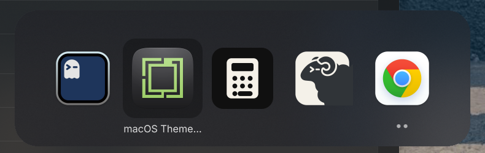
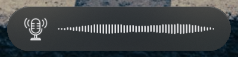

# macOS theme for Omarchy

A dark macOS look for [Omarchy](https://omarchy.org), following Apple's Liquid Glass design: frosted glass on the bar, dock, menus and windows, Apple's system colors, macOS title bars with traffic lights, a macOS-style dock, app and workspace switchers, and a springy feel.



## Install

```bash
git clone https://github.com/tsubaie/omarchy-macos-theme.git
cd omarchy-macos-theme
./install.sh --all      # everything below
./install.sh            # or the theme only, then add pieces with the options
```

| Option | Adds |
|---|---|
| *(none)* | The theme: colors, glass, title bars, gaps, motion, wallpapers |
| `--dock` | The macOS dock |
| `--icons` | MacTahoe macOS icons |
| `--switcher` | App switcher (Alt+Tab) and workspace switcher (Super+Tab) |
| `--wide-menu` | A wider, Spotlight-like Omarchy menu |
| `--menubar` | The macOS menu bar: Inter, the app name in bold, Control Center |
| `--bar-icons` | macOS icons for the bar's Network, Bluetooth, Audio and Display widgets |
| `--osd` | The volume and brightness panel, and the keyboard language when it changes |
| `--dictation-hud` | A dictation panel for [Voxtype](https://voxtype.io) |
| `--lock` | The macOS lock screen |
| `--widgets` | Desktop widgets: clock, calendar, weather and now playing |
| `--all` | All of the above |
| `--uninstall` | Undo everything, the MacTahoe icons too, giving back what each piece replaced; while the macOS theme is current it switches first to the theme you had before it (or `--switch-to <theme>`) |
| `--restore-original` | Go back to before the macOS theme: the backup taken before its first change, whole, and the icons gone. Refuses when there is none (installs from before backups were kept) |
| `--add <piece>` | Only that piece, without the theme: `theme`, `rows`, `icons`, `wide-menu`, `dock`, `switcher`, `osd`, `dictation-hud`, `menubar`, `bar-icons`, `lock` or `widgets` |
| `--remove <piece>` | Remove only that piece (the theme only when another theme is current) |
| `--status [--json]` | Which pieces are installed, whether the theme is current, and the settings |
| `--set glass=<0.75-1>` | How solid the windows you aren't using are; 1 is solid, the theme's own is 0.85. The window you are using is always solid. The menus, launcher, notifications and popups take the same glass. Kept when the theme is updated |
| `--switch-to <theme>` | Switch to that Omarchy theme first if the macOS theme is current, so it can be removed: `--switch-to "Tokyo Night" --uninstall` removes all of it |
| `--set web-glass=<0.5-1>` | The same for browsers, Omarchy's web apps and Electron apps such as Claude and VS Code; solid by default, since their menus are hard to read on glass |
| `--set snapping=<0\|1>` | Turn snapping windows to halves and corners off (0) or on (1) |
| `--set drop-follow=<0\|1>` | Whether dropping a window onto another workspace takes you there too (1, the theme's) or sends it alone (0) |
| `--set reduce-motion=<0\|1>` | Fade windows, menus and workspaces in and out instead of springing and sliding them, without the genie or moving weather; off by default |
| `--bar [--json]` | The bar's items by section, and the hidden ones |
| `--bar-layout '<json>'` | Show, hide and order the bar's items at once: `{"sections":{"right":["omarchy.clock",…],…},"hidden":[…]}`, with sections `left`, `centerBegin`, `center`, `centerEnd`, `right` and `tray`. Only widgets Omarchy knows are taken |
| `--set clock=<left\|center\|right>` | Where the bar's clock sits; the theme puts it on the right, after Control Center |
| `--set volume-hud=<bottom\|top>` | Where the volume and brightness panel shows: the bottom middle (the theme's) or the top right, under the bar, as macOS 27.2 has it |
| `--set dictation-hud=<bottom\|top>` | The same for the dictation panel |
| `--set blur=<0-20>` | How strong the frosted blur is behind see-through windows, menus, the bar and the dock; 0 turns it off (they stay see-through), the theme's own is 10 |
| `--set magnification=<1-2>` | How far dock icons grow under the pointer; 1 turns it off, the theme's own is 1.75 |
| `--set dock-size=<32-80>` | How big the dock's icons are, in points; 48 by default |
| `--set title-bars=<0\|1>` | Turn the title bars with traffic lights off (0) or on (1, the theme's) |
| `--set traffic-lights=<10-20>` | How big the traffic lights are, in points; the bar grows to fit; 14 by default |
| `--show-widgets <list>` | Which desktop widgets show, comma-separated: `clock`, `calendar`, `weather`, `playing`; at least one |
| `--preview --set <setting>` | Show a setting at once without keeping it, for a slider being dragged: no backup, no theme reload; `glass`, `web-glass`, `blur`, `snapping`, `drop-follow`, `title-bars`, `traffic-lights`, `magnification` and `dock-size`. The next Apply (or theme refresh) replaces it |
| `--doctor` | What the running shell logged against the theme's plugins; exits 1 if anything |
| `--backups [--json]` | The backups, newest first. One is taken by itself before every change; the last 10 are kept, and the first one for good |
| `--backup` | Take a backup now |
| `--restore <id>` | Put a backup back (your setup now is backed up first, so it can be undone) |
| `--export <file or folder>` | Your choices in one file: the pieces you use, your settings, your dock and widgets, and wallpapers you added |
| `--import <file>` | Set this computer up from an export, with this version of the theme, so it fits a new install or a newer Omarchy |

### App

[macOS Theme Studio](studio/), in this repository, is a window shaped like macOS System Settings for all of this: a switch for each piece, sliders, Apply, backups and Update. It runs the same `install.sh`.

```bash
curl -fsSL https://raw.githubusercontent.com/tsubaie/omarchy-macos-theme/main/studio/get.sh | bash
```

[Omarchy Sync](https://github.com/tsubaie/OmaSync) has a **macOS Theme** page that does all of this without a terminal: a switch for each piece, sliders for the glass and the dock's magnification, **Apply** to install, remove or set what changed, and **Update** to get the latest version. It downloads this repository to `~/.local/share/omarchy-macos-theme` and runs the same `install.sh` (`--add`, `--remove`, `--set` and `--status --json`), so the page and the script always agree.

Use the script rather than `omarchy theme install <url>`. Themes installed from git have their `.lua` files and `ghostty.conf` removed for safety, and those carry the glass, title bars and gaps. Re-running the script updates everything in place and keeps your wallpaper.

## Features

### The theme

- **Apple colors**: the macOS dark grays (`#1c1c1e`, `#2c2c2e`) and system colors, with Apple's blue `#0a84ff` as the accent.
- **Frosted glass where it belongs**: a clear, blurred top bar; a frosted dock, menus, launcher, notifications and popups, all in the same borderless tinted glass.
  - App windows you aren't using are 85% frosted glass, on floating workspaces too; the one you are using stays solid, so its text reads.
  - Browsers stay solid so their menus stay readable.
  - Ghostty keeps a glass background with solid text. Files, like Finder, has a see-through sidebar and a nearly solid file list.
- **Window title bars** with red, yellow and green circles on the left and the app's name centered, on Apple's dark title-bar gray. Double-click a title bar to maximize. They stay on floating workspaces too.

  

- **Thin glass edges** instead of colored window borders, soft shadows, 16px rounded corners and roomy gaps (6px between windows, 10px at the edges).
- **Motion**: windows and menus pop in with a slight spring, and workspaces slide sideways like macOS Spaces. With **Reduce motion** (`--set reduce-motion=1`, or Studio's Windows page) they fade instead, minimizing skips the genie and the weather widget holds still; Omarchy's own `omarchy toggle animations` still turns every animation off.
- **Striped rows in Files** list view, like Finder, with rounded rows. They come from the theme's `gtk.css`, so they show only while this theme is active.
- **Notifications** on the same frosted glass.

  

- **Inter** for text, the closest free match to Apple's SF Pro, in Regular weight with 13px semibold window titles. Install it with `sudo pacman -S inter-font`. With `--menubar` the bar and popups use it too; terminals keep your Omarchy font.
- **Wallpapers**: two full-resolution (6000×4000) photos, by Pawel Czerwinski (the default) and Martin Martz. Cycle between them with `omarchy theme bg next`.

### Floating windows

On floating workspaces, windows behave like a Mac's:

- **Snapping**, as on macOS and Windows. Drag a window by its title bar:
  - to the left or right edge for half the screen;
  - to a corner for a quarter. An edge is split in thirds: its upper and lower thirds give corners and the middle third the half, so you don't need to reach the very corner;
  - to the top edge, either side of its middle, to fill the screen. The top edge's outer quarters give its corners, and the bottom edge's outer thirds give its corners too;
  - to the very middle of the top edge (with `--switcher`) to move it to another workspace: see below.

  The left and right edges count when the window's own edge reaches them, not only the pointer, so it doesn't matter where you hold the title bar. A frosted outline shows the spot while you drag (with `--dock`), and the window snaps when you let go.
- **A title bar always in reach**: a floating window that ends up above the screen, below it or almost off a side (opened too high, or moved by an app) slides back as soon as it's the active window, just far enough that its title bar is on screen to drag. Super + drag moves any window from anywhere in it too.
- **Snapped windows make room for each other**: a window snapped beside a full-screen one takes its half and the other gives way, and a half gives way to a quarter.
- **Drag a snapped window out** and it gets its own size back.
- **Windows moved here from a tiled workspace** float at a regular size in the middle, instead of filling the screen, and come to the front.
- **Minimize into the dock** with the macOS genie: the yellow button pours the window into its app's dock icon, and clicking the icon pours it back out where it was. The dock brings back the window you minimized, not another one of the same app, and leaves the pointer where it is. Needs the dock (`--dock`); without it, windows minimize plainly.

### macOS dock (`--dock`)

Omarchy's dock, which appears on floating workspaces, reworked to behave like the macOS Dock:

- A borderless frosted platter with 48px icons, and the app's name on hover.
- **Window previews**: hover an open app for a moment and live pictures of its windows appear above it, each with its title (dimmed when minimized). Moving to another app switches to its windows; click one to bring it forward.
- **Magnification** like macOS: icons near the pointer grow (up to 1.75×) and their neighbors slide aside, with the platter stretching to fit. Set how far with `--set magnification=<1-2>` (1 turns it off) and the icons' size with `--set dock-size=<32-80>`, or on Studio's Dock page.
- **Pinned apps on the left.** Running apps that aren't pinned sit to the right of a divider, minimized or not.
- **A dot under every running app.** Pins survive restarts.
- **Right-click an app** for a macOS-style menu: its open windows, New Window, Options › Keep in Dock, and Quit.

  

- **Downloads**: two sheets of paper peek out of the folder when it has files in it. Click to fan your newest downloads up in a column, with "Open in Files" at the top. Right-click for Display as Folder or Stack, and Open "Downloads". Hidden files stay out.

   

- **Trash**: shows paper when it has files. Right-click to Open or Empty Trash (it asks first).

  

- **All apps** grid at the far right, like Launchpad, with search. Right-click an app for a macOS-style menu, including Uninstall, which asks first.
- Menus, the Downloads fan and the Trash menu close when you click anywhere else.
- Windows of apps that don't report an app id still get a proper icon, matched from their title.

### macOS icons (`--icons`)

Installs the [MacTahoe](https://github.com/vinceliuice/MacTahoe-icon-theme) icon theme from its GitHub repository, at a commit the installer pins (default color, into your home folder, no password) and switches to it. App icons, Files, and the dock's Trash and Downloads then look like macOS. As in Finder, Files lists show small blue folders and paper document icons (PDF, images, zip and so on), and the sidebar uses gray outlines. MacTahoe draws small icons as outlines and flat glyphs, so the script swaps in its large icons at those sizes.

### App and workspace switchers, and Mission Control (`--switcher`)

- **Alt+Tab** works like Cmd+Tab: every running app across all workspaces, most recent first, as large icons on frosted glass.
  - Hold Alt and press Tab to move; let go to switch to the app, on whatever workspace it's on.
  - Apps with several windows show a dot per window; press Down to pick a window.
  - A quick Alt+Tab flips between your last two apps.

  

- **Super+Tab** does the same for workspaces, showing each one as a live miniature of its windows. A quick Super+Tab flips between your last two workspaces.
- **Ctrl+Up** opens Mission Control, as on macOS: the workspace's windows fly into a spread over the dimmed wallpaper, live, with the screen's workspaces in a strip along the top.
  - Hover a window to see its title; click it (or press Return) to bring it forward.
  - Click a workspace in the strip to go there, or "+" at its end to go to a new, empty one.
  - Ctrl+Up again, Esc or a click on the wallpaper closes it.
- **Drag a window to the middle of the top edge** to move it to another workspace, as on macOS: the workspaces slide down in a strip, with a "+" for a new one (it goes away again once its last window leaves; workspaces your config pins, such as Omarchy's 1–5, stay). Slide along it and let go on one, and you go there with it (`--set drop-follow=0`, or the app's Windows page, sends it alone). Pull the window back down to carry on the drag. On a tiled workspace the whole top edge opens the strip. A faint outline shows the spot as a drag nears the top.

### macOS menu bar (`--menubar`)

The bar as macOS Tahoe draws it:

- **Inter** for the shell's text (bar, popups, notifications), as macOS uses one sans serif throughout; terminals keep their own font. The bar is 24px tall, as the macOS menu bar is.
- **The focused app's name in bold** right after the menu button, the way macOS shows it next to the Apple menu.
- **Control Center**: one icon by the clock, laid out as macOS has it on the glass of your windows (it follows the Glass setting): Wi-Fi and Bluetooth beside what is playing, with its controls; AirDrop, Tailscale, Focus (Do Not Disturb), Display and Power; then brightness and sound sliders. AirDrop works through [Omdrop](https://github.com/netmojo-systems/omdrop-plugin), AirDrop for Omarchy, which waits unseen in the tray's drawer as the other widgets Control Center stands in for; its icon turns AirDrop on or off and the rest of it opens Omdrop's own window; without it, AirDrop's switch says "Not Installed · Get Omdrop" and opens its page. A click on a switch's round icon turns it on or off; anywhere else on it opens Omarchy's own panel, on the monitor you clicked. Power opens in place to Lock, Log Out, Restart and Shut Down, the last three on a second click. The widgets it stands in for stay on the bar, unseen, which keeps their panels working and their updates coming; only those you have on the bar show in it.
- **The keyboard**: when Control Center opens it takes the keyboard. Tab moves through it, Space flips a switch or plays and pauses, Return opens a switch's panel, the arrows move a slider or skip a track, and Esc closes it. Screen readers get each part's name and state.
- **Camera and microphone in use**: a green and an orange dot by Control Center while an app has the camera or the microphone, and its name at the top of Control Center (for two minutes after, "recently").
- **A soft shade** behind the see-through bar, as Tahoe has, so it reads on any wallpaper.
- **Workspaces you click to go to**: a click goes to a workspace, and a click on the one you're on, or a right-click on any, opens its menu, as a macOS menu-bar item's: Tiling, Scrolling or Floating, each with an icon that maps its windows (Icons8), with a check by the one it has, set without going there, and an item to make it the layout of new workspaces. The workspace you're on shows its layout's icon on a soft light pill, as macOS lights an open menu-bar item. Super+L still cycles the shown one's. (Omarchy's own cycles the layout on a click on the shown workspace.)
- **macOS's arrangement** for Omarchy's own widgets. The right end holds only the tray drawer, the keyboard layout, Control Center and the clock, with the notification bell past it if you have it. The status widgets (indicators, world clock, weather, system update) sit in the middle, and the agents widget joins the drawer.

Widgets from other plugins stay where you put them. To show or hide any widget, drag it between the bar and the tray drawer (the "<"). `--uninstall` puts Omarchy's widgets back in its default layout.

### Spotlight-like menu (`--wide-menu`)

Omarchy's menu and launcher (Super+Space) at about 560px wide instead of 300px, with a magnifying glass and "Search…" instead of "Go…", on the same frosted glass. Everything in it works as before.

### macOS bar icons (`--bar-icons`)

macOS style icons for Omarchy's own Network, Bluetooth, Audio and Display widgets, when they are on the bar (Control Center hides them), and a robot in a speech bubble (Icons8's Message Bot) for its Agents widget, still lit in the alert color when an account runs low. The widgets stay Omarchy's, updates and all: only the icon they draw changes, and Omarchy's comes back for any state without a macOS one.

### Volume panel (`--osd`) and dictation HUD (`--dictation-hud`)

- Volume and brightness as macOS 27.2 shows them: a clear glass capsule with a light rim, at the bottom middle, with an outlined speaker or sun on the left and a bar of sixteen steps. Icons from [Icons8](https://icons8.com) (`plugins/macos-theme.osd/icons8.json`).
- The keyboard language, in the middle of the screen when it changes: its short name large and its full name under it.
- For [Voxtype](https://voxtype.io) dictation: the same panel, the microphone and moving bars while recording, and "Transcribing" after.
- All of them on clearer glass than your windows, as Apple's are; the Glass setting still sets how see-through, over the theme's blur.

  

### Desktop widgets (`--widgets`)
- A column at the top left of the desktop, behind your windows, on frosted glass:
  - **Clock**: an analog face with a red second hand.
  - **Calendar**: the month, with today in a red disc; the week starts as your language has it.
  - **Weather**: the place, temperature, sky, and today's high and low, over a moving scene of the weather outside: a sun or a moon and stars, clouds, rain, snow, fog, lightning, and wind streaks when it blows, with a warm sky at sunrise and sunset. It uses the place you gave Omarchy's weather, or Omarchy's own lookup of your city, and [Open-Meteo](https://open-meteo.com), every 15 minutes; °F only where it is the custom.
  - **Now Playing**: the artwork, song and artist, with previous, play/pause and next, from Omarchy's media service.
- **Drag a widget** to move it: it snaps to a grid, and dropping it on another widget swaps the two. **Right-click a widget** to remove it, or to add back one you removed. Where they sit is saved in `~/.config/omarchy/shell.json` (`widgets.layout`).
- They show on your first screen. To pick another, add `"widgets": { "screen": "HDMI-A-1" }` to `~/.config/omarchy/shell.json`, with a name from `hyprctl monitors`; they move right away.

### Lock screen (`--lock`)
- The date and a large clock at the top, in 12- or 24-hour time as your bar's clock shows it, over the sharp wallpaper.
- Your account picture (`~/.face`, or your initial on a gray disc), your name and a glass password pill at the bottom, with an arrow to submit and the fingerprint icon when one is enrolled.
- A wrong password shakes the field, as on macOS.
- Only the look changes: it is a clone of Omarchy's lock (`omarchy plugin clone omarchy.lock`), and the installer copies this Omarchy's own locking, password and fingerprint code into it each time, then adds the macOS `LockView.qml`. After each `omarchy-update`, a hook (`~/.config/omarchy/hooks/post-update.d/macos-theme-lock`) copies in Omarchy's latest lock code, keeping the macOS view.
- See it without locking: `omarchy-shell lock preview` (click to close).

## Backups

Every change the installer makes is backed up first, to `~/.config/omarchy/macos-theme-backups/snapshots`: your Omarchy shell settings (`shell.json`), `looknfeel.lua`, `gtk.css`, the theme folder and the plugins the theme manages. Plugins and clones of your own are left out, so a restore never touches them. `shell.json`, `looknfeel.lua` and `gtk.css` come back whole, though: an edit you made to them after the backup (a keybinding, a bar change) goes too. The theme's own wallpapers come back from the repository, so a backup is a few hundred KB. The first backup, from before the theme changed anything, is kept for good.

An export is different: it holds your choices rather than files, and an import applies them with the installer it runs in. So an export from one computer fits another, a new install, or a newer version of Omarchy and the theme. Pieces a newer version no longer has are skipped with a note.

## What gets installed

### Plugins

All plugins go into `~/.config/omarchy/plugins/` and are enabled for you.

| Plugin | Option | What it replaces |
|---|---|---|
| `macos-theme.dock` | `--dock` | Omarchy's dock (`omarchy.dock` is turned off while it is installed); it also draws the genie and the snapping outline |
| `macos-theme.switcher` | `--switcher` | Nothing; adds the Alt+Tab and Super+Tab switchers |
| `macos-theme.osd` | `--osd` | Omarchy's on-screen display (`omarchy.osd` is turned off) |
| `macos-theme.dictation-hud` | `--dictation-hud` | Nothing; adds a panel for Voxtype |
| `macos-theme.bar-icons` | `--bar-icons` | Nothing; gives Omarchy's own widgets macOS icons, from the bar, unseen |
| `macos-theme.widgets` | `--widgets` | Nothing; adds the desktop widgets |
| A clone of `omarchy.lock`, named after your user | `--lock` | Omarchy's lock screen (`omarchy.lock` is turned off) |
| A copy of `omarchy.menu`, named after your user | `--wide-menu` | Omarchy's menu (`omarchy.menu` is turned off) |
| `macos-theme.menubar`, `macos-theme.app-name`, `macos-theme.control-center` | `--menubar` | Nothing; the network, Bluetooth, Tailscale, audio, monitor and power widgets stay on the bar unseen, opened from Control Center |
| A clone of `omarchy.workspaces`, named after your user, with `WorkspaceMenu.qml` and the layout icons | `--menubar` | Omarchy's workspaces on the bar; a click goes to a workspace, and a click on the one shown or a right-click opens its layout menu. Each `--menubar` takes Omarchy's widget afresh and patches it, so its updates come along |

`--icons` installs the MacTahoe icon theme, which is not a plugin, into `~/.local/share/icons`.

### Files changed

Each run takes a snapshot first (see [Backups](#backups)). A removed theme folder is kept in `~/.config/omarchy/macos-theme-backups/`.

| File | Change |
|---|---|
| `~/.config/omarchy/themes/macos/` | The theme itself |
| `~/.config/hypr/looknfeel.lua` | One line at the end that loads the theme's `look.lua`, so its look applies only while this theme is active |
| `~/.config/gtk-4.0/gtk.css` | Two imports from the current theme's folder: blur for GTK apps like Files, and the theme's striped Files rows. Both apply only while this theme is active |
| `~/.config/omarchy/plugins/` | The plugins you chose |
| `~/.config/omarchy/shell.json` | Turns on the plugins and turns off the Omarchy ones they replace |
| `~/.config/omarchy/hooks/post-update.d/macos-theme-lock` | With `--lock`: refreshes the lock screen's Omarchy code after each update |

### Impact on your system

- **Keyboard shortcuts** change only while this theme is active. With `--switcher`, Alt+Tab and Super+Tab open the switchers; switching to another theme gives you Omarchy's shortcuts back.
- **The window look** (title bars, glass, gaps, rounded corners) applies only while this theme is active. Other themes are untouched.
- **Replaced Omarchy parts** (dock, on-screen display, menu) are copies, so they don't get Omarchy's updates to those parts. Re-run `./install.sh` after a big Omarchy update; `--wide-menu` re-copies the menu from your installed Omarchy version.
- **Performance**: blur and see-through windows cost a little GPU time. The workspace switcher captures windows live only while it is open.
- **No sudo** is needed, and nothing outside your home folder is touched.
- **Downloads**: `--icons` fetches one pinned commit of MacTahoe from GitHub (about 100 MB; about 220 MB once installed). Nothing else is downloaded.

## Uninstall

```bash
./install.sh --uninstall            # remove it; your other changes since stay
./install.sh --restore-original     # or go back to exactly how things were before it
```

Or in [macOS Theme Studio](studio/): **Remove macOS Theme…** on its About page does either.

**`--uninstall`** removes the theme, its plugins, its clones of Omarchy's menu, lock and workspaces, and the MacTahoe icons it installed (icons installed some other way stay), and turns back on what stood in their place before the theme: Omarchy's own dock, on-screen display, menu and lock, or a clone of your own, or nothing where you had turned it off. The bar goes back to how it was before the menu bar, Alt+Tab to your own binding, and the lines added to `looknfeel.lua` and `gtk.css`, and the lock screen's update hook, come out. While the macOS theme is current, it first switches to the theme you had before installing it (Tokyo Night when that isn't known; `--switch-to <theme>` picks another). Your dock's pinned apps stay pinned in Omarchy's dock, and its size and magnification stay in `shell.json` for when it comes back, which Omarchy's dock ignores. Changes you made since, to the bar or anything else, stay.

**`--restore-original`** puts back the backup taken before the theme's first change: `shell.json`, `looknfeel.lua` and `gtk.css` whole, the plugins as they were, and the theme that was current, with the theme's icons gone. Edits you made to those three files since, a keybinding or a bar widget, go too. Undoing it brings the theme back but not the icons, which backups don't hold; `--add icons` does. A computer where the theme was installed before backups were kept has no such backup; use `--uninstall` there.

Either way, the theme folder is kept in `~/.config/omarchy/macos-theme-backups/`, wallpapers of yours included, and every backup stays, so it can be undone with `--restore` (the installer prints the backup to restore). Delete that folder once you're sure. If you had turned Voxtype's own overlay off for the dictation pill, the installer says how to turn it back on.

## Customize

The window look lives in `~/.config/omarchy/themes/macos/look.lua`. Edit it, then run `hyprctl reload`.

- **Window glass**: `o.window(".*", { opacity = "1 0.85" })`, the window you are using and the others. Use `1 1` for solid windows, or add an app's class to the solid list below that line (find it with `hyprctl clients`).
- **Gaps, corners, blur**: in the `hl.config` block at the top.
- **Title bars**: in the `hyprbars` block.
- **Snapping**: `SNAP_EDGE` is how close to an edge (in pixels) a drag must come, and `SNAP_CORNER` how much of each edge counts as a corner (a third by default).

Bar, menu, launcher, notification and popup colors and transparency are in `shell.toml` in the same folder. If you have your own `~/.config/omarchy/shell.toml`, its values win.

## Good to know

- Needs Omarchy 4 (Lua Hyprland config). The title bars use the plugin Omarchy ships for floating workspaces.
- The dock appears on floating workspaces, as Omarchy's does. Press Super+L, or with the menu bar right-click a workspace in the bar, to change a workspace's layout.
- Title bars fade with their window, so on a window you aren't using they are as see-through as the Glass setting (85% by default). Hyprland fades a window as a whole.
- Apps that draw their own title bar (like Brave or Files) show the macOS strip above it.

## Tests

```bash
tests/run.sh            # everything: the installer, Studio, an upgrade from an older version
tests/run.sh --quick    # the installer's tests only, without building Studio
./install.sh --doctor   # what the running shell logged against the theme's plugins
```

Most tests run the real `install.sh` in a throwaway home with a fake `omarchy`, so they never touch your setup. `tests/omarchy-compat.test.js` checks the theme against the Omarchy installed here: the menu and workspaces patches still apply, Omarchy's lock still drives `lock/LockView.qml`, Omarchy accepts each plugin, and no QML file has a syntax error. Run `tests/run.sh` after `omarchy-update`, and `--doctor` after reloading the shell. GitHub runs everything that doesn't need Omarchy on each push.

## Credits

- Wallpapers: [photo by Pawel Czerwinski on Unsplash](https://unsplash.com/photos/ZkzobNDayXo) and [photo by Martin Martz on Unsplash](https://unsplash.com/photos/DI0lpZocxl4), used under the [Unsplash License](https://unsplash.com/license).
- The dock, volume capsule and wide menu are modified copies of Omarchy's own dock, on-screen display and menu ([Omarchy](https://github.com/basecamp/omarchy), MIT License).
- Icons: [MacTahoe icon theme](https://github.com/vinceliuice/MacTahoe-icon-theme) by vinceliuice (GPL-3.0), downloaded from its own repository by `--icons`, not bundled here.
- Colors follow Apple's published dark-mode system colors. This project isn't affiliated with or endorsed by Apple. macOS and Liquid Glass are trademarks of Apple Inc.

## License

MIT, except the wallpapers, which follow the Unsplash License.
