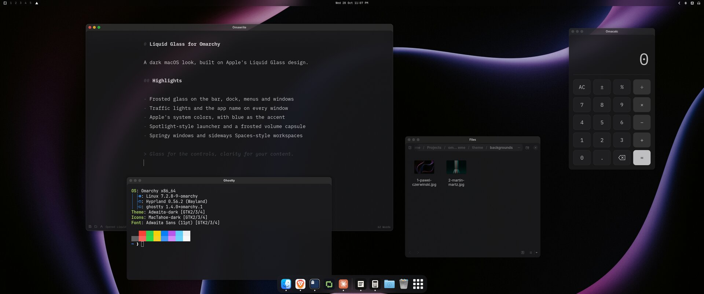
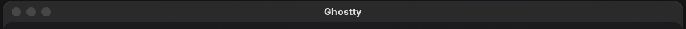
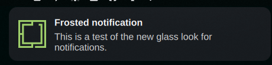
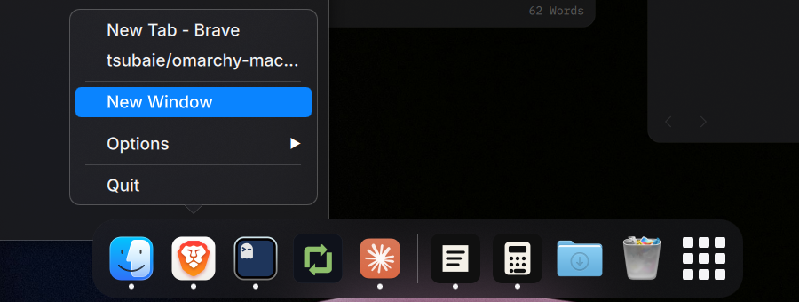
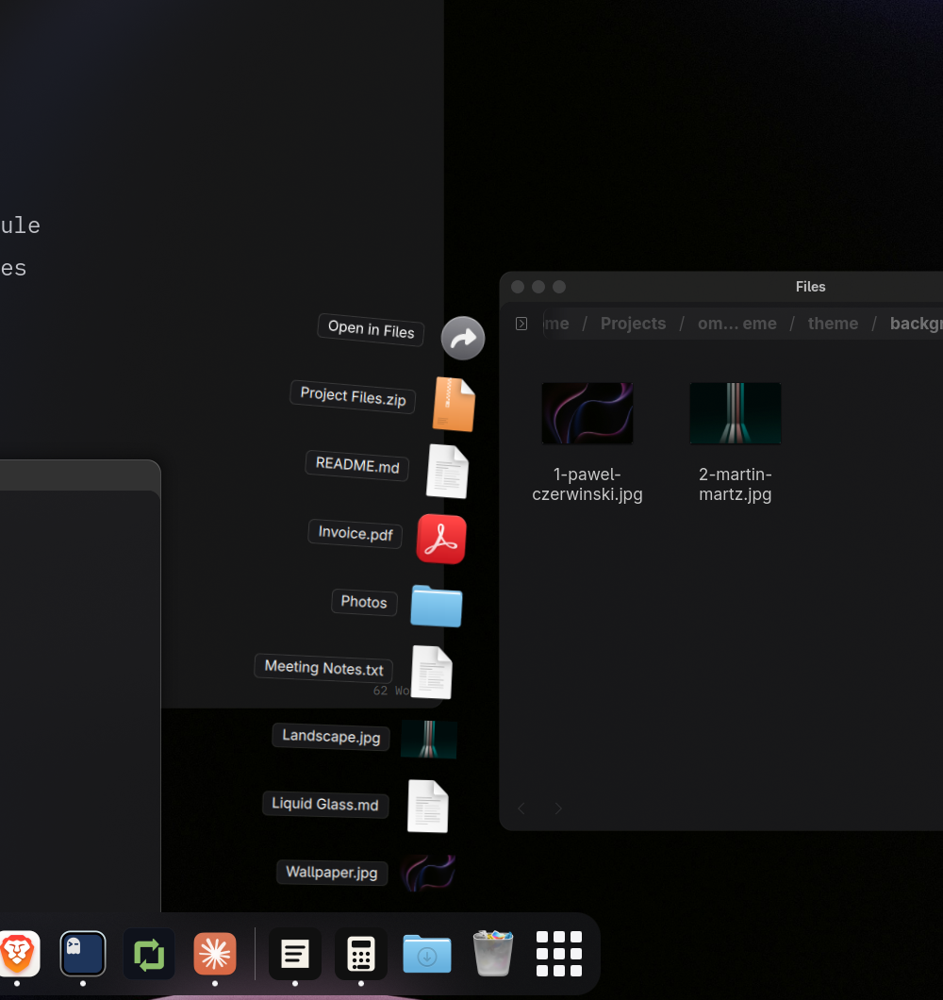
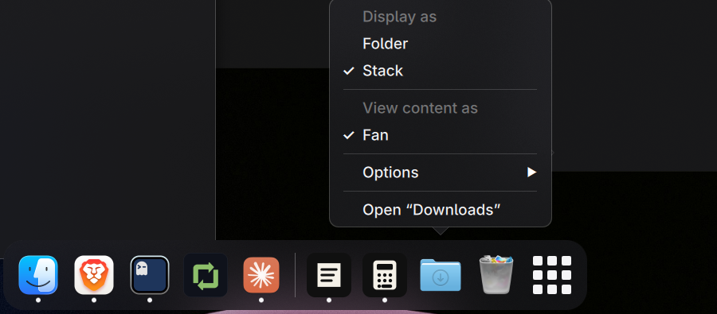
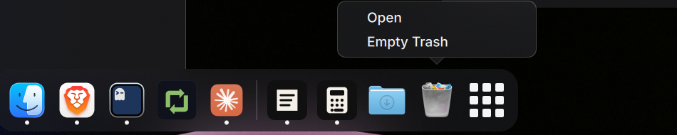
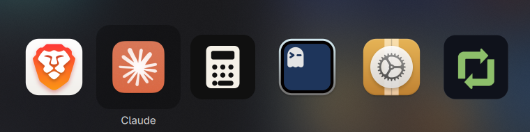
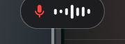

# macOS theme for Omarchy

A dark macOS look for [Omarchy](https://omarchy.org), following Apple's Liquid Glass design: frosted glass on the bar, dock, menus and windows, Apple's system colors, macOS title bars with traffic lights, a macOS-style dock, app and workspace switchers, and a springy feel.



## Install

```bash
git clone https://github.com/tsubaie/omarchy-macos-theme.git
cd omarchy-macos-theme
./install.sh --all      # everything below
./install.sh            # or the theme only, then add pieces with the options
```

| Option | Adds |
|---|---|
| *(none)* | The theme: colors, glass, title bars, gaps, motion, wallpapers |
| `--dock` | The macOS dock |
| `--icons` | MacTahoe macOS icons |
| `--switcher` | App switcher (Alt+Tab) and workspace switcher (Super+Tab) |
| `--wide-menu` | A wider, Spotlight-like Omarchy menu |
| `--osd` | The frosted volume and brightness capsule |
| `--dictation-hud` | A dictation pill for [Voxtype](https://voxtype.io) |
| `--all` | All of the above |
| `--uninstall` | Undo everything (switch to another theme first) |

Use the script rather than `omarchy theme install <url>`. Themes installed from git have their `.lua` files and `ghostty.conf` removed for safety, and those carry the glass, title bars and gaps. Re-running the script updates everything in place and keeps your wallpaper.

## Features

### The theme

- **Apple colors**: the macOS dark grays (`#1c1c1e`, `#2c2c2e`) and system colors, with Apple's blue `#0a84ff` as the accent.
- **Frosted glass where it belongs**: a clear, blurred top bar; a frosted dock, menus, launcher, notifications and popups, all in the same borderless tinted glass.
  - App windows are 70% frosted glass, on floating workspaces too.
  - Browsers stay solid so their menus stay readable.
  - Ghostty keeps a glass background with solid text.
- **Window title bars** with red, yellow and green circles on the left and the app's name centered, on Apple's dark title-bar gray. Double-click a title bar to maximize. They stay on floating workspaces too.

  

- **Minimize into the dock**: the yellow button shrinks the window into the dock. This works on floating workspaces, where Omarchy can minimize.
- **Thin glass edges** instead of colored window borders, soft shadows, 16px rounded corners and roomy gaps (6px between windows, 10px at the edges).
- **Motion**: windows and menus pop in with a slight spring, and workspaces slide sideways like macOS Spaces.
- **Notifications** on the same frosted glass.

  

- **Inter** for text, the closest free match to Apple's SF Pro, in Regular weight with 13px semibold window titles. Install it with `sudo pacman -S inter-font`; the bar keeps your Omarchy font (`omarchy font set` changes it).
- **Wallpapers**: two full-resolution (6000×4000) photos, by Pawel Czerwinski (the default) and Martin Martz. Cycle between them with `omarchy theme bg next`.

### macOS dock (`--dock`)

Omarchy's dock, which appears on floating workspaces, reworked to behave like the macOS Dock:

- A borderless frosted platter with 48px icons, and the app's name on hover.
- **Pinned apps on the left.** Running apps that aren't pinned sit to the right of a divider, minimized or not.
- **A dot under every running app.** Pins survive restarts.
- **Right-click an app** for a macOS-style menu: its open windows, New Window, Options › Keep in Dock, and Quit.

  

- **Downloads**: click to fan your newest downloads up in a column, with "Open in Files" at the top. Right-click for Display as Folder or Stack, and Open "Downloads". Hidden files stay out.

   

- **Trash**: shows paper when it has files. Right-click to Open or Empty Trash (it asks first).

  

- **All apps** grid at the far right, like Launchpad, with search.
- Menus, the Downloads fan and the Trash menu close when you click anywhere else.
- Windows of apps that don't report an app id still get a proper icon, matched from their title.

### macOS icons (`--icons`)

Installs the [MacTahoe](https://github.com/vinceliuice/MacTahoe-icon-theme) icon theme from its GitHub repository (default color, into your home folder, no password) and switches to it. App icons, Files, and the dock's Trash and Downloads then look like macOS.

### App and workspace switchers (`--switcher`)

- **Alt+Tab** works like Cmd+Tab: every running app across all workspaces, most recent first, as large icons on frosted glass.
  - Hold Alt and press Tab to move; let go to switch to the app, on whatever workspace it's on.
  - Apps with several windows show a dot per window; press Down to pick a window.
  - A quick Alt+Tab flips between your last two apps.

  

- **Super+Tab** does the same for workspaces, showing each one as a live miniature of its windows. A quick Super+Tab flips between your last two workspaces.

### Spotlight-like menu (`--wide-menu`)

Omarchy's menu and launcher (Super+Space) at about 560px wide instead of 300px, with a magnifying glass and "Search…" instead of "Go…", on the same frosted glass. Everything in it works as before.

### Volume capsule (`--osd`) and dictation HUD (`--dictation-hud`)

- The volume and brightness popup as a frosted pill with a white slider.
- For [Voxtype](https://voxtype.io) dictation: a frosted pill with a red mic and moving bars while recording, and "Transcribing" after.

  

## What gets installed

### Plugins

All plugins go into `~/.config/omarchy/plugins/` and are enabled for you.

| Plugin | Option | What it replaces |
|---|---|---|
| `macos-theme.dock` | `--dock` | Omarchy's dock (`omarchy.dock` is turned off while it is installed) |
| `macos-theme.switcher` | `--switcher` | Nothing; adds the Alt+Tab and Super+Tab switchers |
| `macos-theme.osd` | `--osd` | Omarchy's on-screen display (`omarchy.osd` is turned off) |
| `macos-theme.dictation-hud` | `--dictation-hud` | Nothing; adds a pill for Voxtype |
| A copy of `omarchy.menu`, named after your user | `--wide-menu` | Omarchy's menu (`omarchy.menu` is turned off) |

`--icons` installs the MacTahoe icon theme, which is not a plugin, into `~/.local/share/icons`.

### Files changed

Each file is backed up first (as `*.bak.<timestamp>`; an existing `macos` theme goes to `~/.config/omarchy/macos-theme-backups/`).

| File | Change |
|---|---|
| `~/.config/omarchy/themes/macos/` | The theme itself |
| `~/.config/hypr/looknfeel.lua` | One line at the end that loads the theme's `look.lua`, so its look applies only while this theme is active |
| `~/.config/gtk-4.0/gtk.css` | One import so GTK apps like Files get blur |
| `~/.config/omarchy/plugins/` | The plugins you chose |
| `~/.config/omarchy/shell.json` | Turns on the plugins and turns off the Omarchy ones they replace |

### Impact on your system

- **Keyboard shortcuts** change only while this theme is active. With `--switcher`, Alt+Tab and Super+Tab open the switchers; switching to another theme gives you Omarchy's shortcuts back.
- **The window look** (title bars, glass, gaps, rounded corners) applies only while this theme is active. Other themes are untouched.
- **Replaced Omarchy parts** (dock, on-screen display, menu) are copies, so they don't get Omarchy's updates to those parts. Re-run `./install.sh` after a big Omarchy update; `--wide-menu` re-copies the menu from your installed Omarchy version.
- **Performance**: blur and see-through windows cost a little GPU time. The workspace switcher captures windows live only while it is open.
- **No sudo** is needed, and nothing outside your home folder is touched.
- **Downloads**: `--icons` clones MacTahoe from GitHub (about 100 MB; about 220 MB once installed). Nothing else is downloaded.

## Uninstall

```bash
omarchy theme set catppuccin   # or any other theme
./install.sh --uninstall
```

This removes the theme and plugins, turns Omarchy's dock, on-screen display and menu back on, and takes out the lines added to `looknfeel.lua` and `gtk.css`. MacTahoe icons stay installed; the script prints how to remove them.

## Customize

The window look lives in `~/.config/omarchy/themes/macos/look.lua`. Edit it, then run `hyprctl reload`.

- **Window glass**: `o.window(".*", { opacity = "0.7 0.7" })`. Use `1 1` for solid windows, or add an app's class to the solid list below that line (find it with `hyprctl clients`).
- **Gaps, corners, blur**: in the `hl.config` block at the top.
- **Title bars**: in the `hyprbars` block.

Bar, menu, launcher, notification and popup colors and transparency are in `shell.toml` in the same folder. If you have your own `~/.config/omarchy/shell.toml`, its values win.

## Good to know

- Needs Omarchy 4 (Lua Hyprland config). The title bars use the plugin Omarchy ships for floating workspaces.
- The dock appears on floating workspaces, as Omarchy's does. Click the current workspace in the bar (or press Super+L) to change a workspace's layout.
- Title bars fade with their window, so on glass windows they are about 70% opaque. Hyprland fades a window as a whole.
- Apps that draw their own title bar (like Brave or Files) show the macOS strip above it.

## Credits

- Wallpapers: [photo by Pawel Czerwinski on Unsplash](https://unsplash.com/photos/ZkzobNDayXo) and [photo by Martin Martz on Unsplash](https://unsplash.com/photos/DI0lpZocxl4), used under the [Unsplash License](https://unsplash.com/license).
- The dock, volume capsule and wide menu are modified copies of Omarchy's own dock, on-screen display and menu ([Omarchy](https://github.com/basecamp/omarchy), MIT License).
- Icons: [MacTahoe icon theme](https://github.com/vinceliuice/MacTahoe-icon-theme) by vinceliuice (GPL-3.0), downloaded from its own repository by `--icons`, not bundled here.
- Colors follow Apple's published dark-mode system colors. This project isn't affiliated with or endorsed by Apple. macOS and Liquid Glass are trademarks of Apple Inc.

## License

MIT, except the wallpapers, which follow the Unsplash License.
