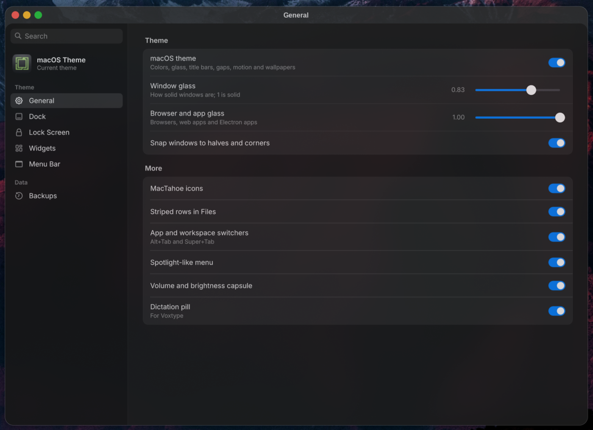

# macOS Theme Studio

Install, customize, back up and update the [macOS theme for Omarchy](https://github.com/tsubaie/omarchy-macos-theme), in a window shaped like macOS System Settings.



The macOS theme turns [Omarchy](https://omarchy.org) into a dark macOS look: frosted glass, title bars with traffic lights, a macOS dock, a lock screen, desktop widgets, a menu bar with Control Center, and more. Its installer, `install.sh`, does everything from the terminal. This app does the same without a terminal: a switch for each part of the theme, sliders for its settings, backups you can restore, and one button to update.

Made for Omarchy 4 and later. Open source, MIT.

## Contents

- [What it does](#what-it-does)
- [Install](#install)
- [Using it](#using-it)
- [What a change touches](#what-a-change-touches)
- [How it works](#how-it-works)
- [Building from source](#building-from-source)
- [Project layout](#project-layout)
- [Development](#development)
- [Design](#design)
- [Troubleshooting](#troubleshooting)
- [Credits and license](#credits-and-license)

## What it does

| Page | What's on it |
|---|---|
| **About** (the theme card at the top of the sidebar) | The app's version, the Omarchy versions it's made for, whether the theme is up to date with an **Update** button when it isn't, and links to both projects |
| **General** | The theme itself, the MacTahoe icons, striped rows in Files, the app and workspace switchers, the Spotlight-like menu, the volume and brightness capsule, and the dictation pill |
| **Windows** | How see-through windows are, the same for browsers and Electron apps (Claude, VS Code, Slack…), how strong the frosted blur behind them is, and snapping windows to halves and corners |
| **Dock** | The macOS dock (magnification, window previews, Downloads and Trash) and how far its icons grow |
| **Lock Screen** | The macOS lock screen, and a **Show** button to see it without locking |
| **Widgets** | The desktop widgets: clock, calendar, weather and now playing |
| **Menu Bar** | The macOS menu bar: Inter, the app's name in bold, and Control Center; and every item on the bar, in Left, Center and Right, to show or hide with a switch and drag to rearrange (the clock too) |
| **Backups** | Back up now, restore any backup, and export or import your setup |

- **Changes wait for Apply.** Flipping switches and moving sliders changes nothing until you press **Apply** in the toolbar at the top. Then every change goes to the installer in one call, so the theme reloads once. **Revert** throws the changes away.
- **Every change is backed up first**, by the theme's installer, and can be restored from **Backups**.
- **Search** at the top of the sidebar finds pages and the settings on them as you type: "glass" finds General, "weather" finds Widgets. Ctrl+F focuses it; ↑ and ↓ move through the results, Return opens one, Esc clears it.
- **Updates.** When the app opens it asks GitHub whether the theme has new commits. If it has, the theme card in the sidebar and the About page say **Update available**, and **Update** brings the theme up to date.
- **It reopens on the page you last used**, and the window's title follows the page, as in macOS.

## Install

The app needs Omarchy and Rust. Omarchy already has Qt 6, which the app uses.

```bash
sudo pacman -S rust
git clone https://github.com/tsubaie/omarchy-macos-studio.git
cd omarchy-macos-studio
cargo build --release
./target/release/omarchy-macos-studio
```

To put it in the app launcher, with its name and icon (which the bar, the dock and the app switcher show for its window):

```bash
./install-desktop.sh                                  # it manages ~/.local/share/omarchy-macos-theme
./install-desktop.sh ~/Projects/omarchy-macos-theme   # or a checkout of the theme
./install-desktop.sh --remove                         # take it out again
```

The first build compiles CXX-Qt's C++ and takes a few minutes; later builds take seconds. The program is about 2 MB and uses about 70 MB of memory while open, nothing while closed.

On first run, if the theme isn't downloaded yet, the app offers a **Download** button. It clones the theme into `~/.local/share/omarchy-macos-theme`, the same place [Omarchy Sync](https://github.com/tsubaie/OmaSync) keeps it, so the two share one copy.

An Arch package (AUR) is planned.

## Using it

### Turning parts on and off

Each switch is one part ("piece") of the theme. Flip the ones you want, then press **Apply** in the bar at the bottom. While it works, the bar says "Applying…"; afterwards the switches show what is really installed. If the installer refuses something, its own message appears in red at the top, and your changes stay marked so you can fix them and apply again.

Turning off **macOS theme** while it's your current Omarchy theme is refused: switch to another theme first (`omarchy theme set <name>`), as the installer explains.

### Settings

| Setting | Range | The theme's default |
|---|---|---|
| Window glass | 0.5 (see-through) to 1 (solid) | 0.7 |
| Browser and app glass | 0.5 to 1 | 1 (solid, since browser menus are hard to read on glass) |
| Frosted blur | 0 (off; see-through windows stay see-through, unblurred) to 20 | 10 |
| Snapping | on or off | on |
| Dock magnification | 1 (off) to 2 | 1.75 |

Settings are kept when the theme is updated.

### Backups

The theme's installer backs up what it is about to change before every change, so any change can be undone:

- **Back Up Now** takes a backup by hand.
- Each backup is listed with when it was taken and what changed after it ("Added dock", "glass 0.8"). **Restore** puts it back after asking, and backs up your setup first, so a restore can be undone too.
- The last 10 backups are kept, and the very first one for good. On a computer where the theme is new, that first one is "Before macOS theme": Omarchy as it was.
- Backups are small, a few hundred KB, because the theme's own wallpapers come back from the repository instead of being copied.

### Export and import

**Export…** saves your choices to one file: which pieces you use, your settings, your dock (its pinned apps) and widgets (their layout and screen), and wallpapers you added. **Import…** sets another computer up from that file. It re-applies the choices with the installer it runs in, rather than copying files, so an export fits a new install or a newer version of Omarchy and the theme. Pieces a newer version no longer has are skipped with a note. Import backs up first, and refuses any file that holds anything other than a profile and images.

### Updating the theme

When **Update available** shows, press **Update**. After you confirm, the app pulls the theme's new commits and installs the pieces you use again, in one installer call that backs up first and reloads the theme once. The MacTahoe icons aren't reinstalled: they come from their own project, not from the theme.

If the theme folder has changes of its own that can't be fast-forwarded, the update stops with git's message and nothing is installed.

## What a change touches

The app never edits your files itself. The theme's installer does, and only these:

| File or folder | What for |
|---|---|
| `~/.config/omarchy/shell.json` | Omarchy's bar, dock and plugin settings, and the widgets' layout |
| `~/.config/hypr/looknfeel.lua` | One line that loads the theme's look |
| `~/.config/gtk-4.0/gtk.css` | Blur for GTK apps, and the striped rows in Files |
| `~/.config/omarchy/themes/macos` | The theme itself |
| `~/.config/omarchy/plugins/macos-theme.*` | The theme's plugins, and its copies of Omarchy's menu and lock |

Never touched: other plugins, your keybindings, your apps and their settings, your terminal font. Applying reloads Hyprland and restarts Omarchy's shell, so the bar and dock blink once; your windows and apps stay open.

The app keeps two small things of its own: the last page you viewed (`~/.config/omarchy/macOS Theme Studio.conf`) and Omarchy's logo recolored in its green for the About page (in the system's temporary folder).

## How it works

```
┌────────────── QML (the window) ──────────────┐
│  Sidebar · pages · switches · sliders · Apply │
└──────────────────────┬────────────────────────┘
                       │ ThemeBackend (CXX-Qt object)
┌──────────────────────▼────────────────────────┐
│  Rust: checks every request, runs install.sh  │
│  and git on a worker thread, reports back     │
└──────────────────────┬────────────────────────┘
                       │
        install.sh in the theme folder ── changes your setup
        git ── checks for and pulls theme updates
```

- **The installer is the single source of truth.** The app asks it what is installed (`install.sh --status --json`) and has it make every change (`--add`, `--remove`, `--set`, `--backup`, `--restore`, `--export`, `--import`). The app, the terminal and Omarchy Sync therefore always agree.
- **Nothing unchecked reaches the installer.** Piece names, setting keys and ranges, and backup ids are checked in Rust before any command runs, so the window can't pass the installer anything it wouldn't accept.
- **The window never stalls.** Every installer and git call runs on a worker thread, one at a time, and the result comes back to the window's thread. While one runs, the controls wait.
- **Rust and QML.** The window is QML (Qt Quick), compiled into the program; the logic is Rust, bridged with [CXX-Qt](https://github.com/KDAB/cxx-qt) 0.10. It links to the Qt 6 that Omarchy already has, so the program stays small.

## Building from source

Requirements:

- Rust 1.85 or later (`sudo pacman -S rust`; built and tested with 1.99)
- Qt 6 with Qt Quick, Qt Quick Dialogs and Qt SVG (Omarchy has them: `qt6-base`, `qt6-declarative`, `qt6-svg`; tested with 6.12)
- A C++ compiler (Omarchy has `clang` and `gcc`)

CXX-Qt finds Qt through `qmake6`. If your system names it differently, set `QMAKE`:

```bash
QMAKE=qmake6 cargo build --release
```

To work against a checkout of the theme instead of the downloaded copy:

```bash
OMARCHY_MACOS_THEME_DIR=~/Projects/omarchy-macos-theme ./target/release/omarchy-macos-studio
```

Open a given page with `--page <id>`: `overview`, `general`, `windows`, `dock`, `lock`, `widgets`, `menubar` or `backups`.

## Project layout

```
src/
  main.rs        Starts Qt, the font, and loads the window
  theme.rs       ThemeBackend: the object QML talks to (properties and actions)
  install.rs     Everything that runs install.sh and git, with the checks and tests
qml/
  Main.qml       The window: sidebar, search, pages, Apply bar, dialogs
  SearchField.qml, MacSwitch.qml, MacSlider.qml, Group.qml, SettingRow.qml
                 The macOS controls
assets/
  icon.svg, icon-mono.svg, icon-omarchy.svg
                 The app icon in color, mono, and Omarchy's green (the one in use)
  make_icon.py, trace_mark.py, mark.txt
                 Regenerate the icon (see the script's header)
  icons/         The sidebar and search icons (Icons8)
icons8.json      The icon pack and ids, so new icons match
build.rs         The QML module and the files compiled in
dev.sh           Watch mode
```

## Development

### Watch mode

```bash
./dev.sh ~/Projects/omarchy-macos-theme
```

Rebuilds and reopens the app on the same page whenever a file in `qml/`, `src/` or `assets/` is saved. A failed build leaves the last good app open, with the errors above it. Needs `inotify-tools`.

### Checks

```bash
cargo fmt
cargo clippy --all-targets -- -D warnings
cargo test
```

`node tests/bar-model.test.js` tests the menu bar's Left, Center and Right groups, and `QT_QPA_PLATFORM=offscreen /usr/lib/qt6/bin/qmltestrunner -input tests/qml` drives real presses, drags and releases on its rows: moving within and between groups, hiding and showing, dropping into an empty group, letting go over nothing, the page holding still under a drag and scrolling at its edges, and several drags in a row.

The Rust tests cover what can go wrong between the window and the installer: piece names, settings and their ranges, how changes combine into one installer call, refusing bad changes before anything runs, reading the installer's status and backups, backup ids, which pieces an update reinstalls, and recoloring Omarchy's logo.

### The app icon

```bash
cd assets
python3 make_icon.py mark.txt omarchy > icon-omarchy.svg   # in use: graphite and Omarchy's green
python3 make_icon.py mark.txt mono > icon-mono.svg         # graphite and white
python3 make_icon.py mark.txt > icon.svg                   # lime on deep teal
```

## Design

The app follows Apple's [Human Interface Guidelines](https://developer.apple.com/design/human-interface-guidelines) for macOS, translated to Qt Quick:

- **Search at the top of the sidebar**, filtering it as people type, as System Settings does ([Search fields](https://developer.apple.com/design/human-interface-guidelines/search-fields)).
- **A full-height sidebar** with gray line symbols, section headings and a soft gray selection, as Finder draws it with the graphite accent ([Sidebars](https://developer.apple.com/design/human-interface-guidelines/sidebars)).
- **Switches in the accent blue at the small size** macOS uses in grouped rows, so rows keep one height ([Toggles](https://developer.apple.com/design/human-interface-guidelines/toggles)).
- **The window title follows the page, and the last page is restored** ([Settings](https://developer.apple.com/design/human-interface-guidelines/settings)).
- **macOS text sizes**: 13 pt body, 13 pt semibold headings ([Typography](https://developer.apple.com/design/human-interface-guidelines/typography)).
- **Color only where it means something**: the controls and the Apply button; everything else neutral ([Color](https://developer.apple.com/design/human-interface-guidelines/color)).
- **Screen-reader names and roles** for every switch, slider, button and page, and text contrast of at least 4.5:1 ([Accessibility](https://developer.apple.com/design/human-interface-guidelines/accessibility)).
- **Traffic lights in the sidebar and a toolbar across the top**, as Apple's own apps draw their windows: the page's title on the left, the changes waiting and **Apply** on the right, and the top of the window to drag it by. The theme turns its title bar off for this app only.

## Troubleshooting

| What you see | Why, and what to do |
|---|---|
| "Switch to another theme first" | The macOS theme can't be removed while it is the current theme. Run `omarchy theme set <another theme>`, then apply again. |
| Download fails | The app clones from GitHub with git; check that git is installed and you are online. |
| Update stops with a git message | The theme folder has changes of its own that can't be fast-forwarded. Commit or discard them in `~/.local/share/omarchy-macos-theme`, then update again. |
| Backups is empty | The theme is older than its backups feature; updating it brings backups. |
| The window doesn't look like the screenshots | The macOS theme isn't the current Omarchy theme, or the Inter font is missing (`sudo pacman -S inter-font`). |
| The build can't find Qt | Set `QMAKE=qmake6` (or the path to your `qmake`) before `cargo build`. |

## Credits and license

- **[Omarchy](https://omarchy.org)**, the desktop this is made for. Its logo on the About page is read from your Omarchy install, recolored in Omarchy's green, and isn't shipped with this app. The app icon is a redrawing of Omarchy's mark.
- **[CXX-Qt](https://github.com/KDAB/cxx-qt)** by KDAB, for Rust and Qt together.
- **Icons by [Icons8](https://icons8.com)**: the SF Symbols style set for the sidebar and search field.
- **[Inter](https://rsms.me/inter/)**, the typeface.

Not affiliated with Apple or Omarchy. macOS is a trademark of Apple Inc.

MIT license; see [LICENSE](LICENSE).
