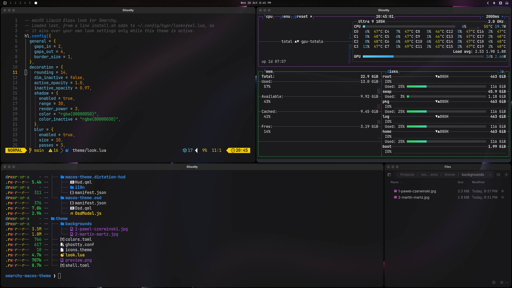

# macOS theme for Omarchy

A dark macOS look for [Omarchy](https://omarchy.org), following Apple's Liquid Glass design: frosted glass on the bar, dock, menus and windows, Apple's system colors, macOS window title bars with traffic lights, and a springy feel.



## What you get

- **Apple colors**: the macOS dark grays (`#1c1c1e`, `#2c2c2e`) and system colors, with Apple's blue `#0a84ff` as the accent.
- **Frosted glass**: a clear, blurred top bar, plus frosted dock, menus, launcher, notifications and popups. App windows are 80% frosted glass; browsers stay solid so their menus and downloads list stay readable.
- **Window title bars**: red, yellow and green circles on the left and the app's name centered, on Apple's dark title-bar gray. Double-click a title bar to maximize.
- **Thin glass edges** instead of colored window borders, plus soft shadows, 14px rounded corners and even 4px gaps.
- **Spotlight-style launcher and menus**: the selected row in blue, with no dimming behind.
- **Motion**: windows and menus pop in with a slight spring, and workspaces slide sideways like macOS Spaces.
- **Ghostty**: a frosted background with solid text.
- **Wallpapers**: two full-resolution (6000×4000) photos, by Pawel Czerwinski (the default) and Martin Martz. Cycle between them with `omarchy theme bg next`.

Optional extras:

- **Volume capsule** (`--osd`): the volume and brightness popup as a frosted pill with a white slider.
- **macOS dock** (`--dock`): a dot under every running app, then a divider with Downloads, each minimized window on its own, and Trash at the end. Click a minimized window to bring it back. Downloads fans your newest downloads up in a column (click one to open it, or "Open in Files" at the top), and right-clicking Trash offers Open and Empty Trash (it asks first).
- **macOS icons** (`--icons`): installs the [MacTahoe](https://github.com/vinceliuice/MacTahoe-icon-theme) icon theme from GitHub (default color only, into your home folder) and switches to it, so app icons, Files, and the dock's Trash and Downloads look like macOS.
- **App switcher** (`--switcher`): Alt+Tab like Cmd+Tab on a Mac. Every running app across all workspaces, most recent first, as large icons on frosted glass. Tab / Shift+Tab move while Alt is held, letting go of Alt switches (going to the app's workspace), Esc cancels. Apps with several windows show a dot per window; press Down (or `) to list them and pick one.
  Super+Tab is the same for workspaces: each workspace appears as a miniature with its windows drawn live, Tab / Shift+Tab move while Super is held, and letting go of Super switches.
- **Dictation HUD** (`--dictation-hud`): a frosted pill with a red mic and moving bars while [Voxtype](https://voxtype.io) is recording, and "Transcribing" with pulsing dots after.

## Install

```bash
git clone https://github.com/tsubaie/omarchy-macos-theme.git
cd omarchy-macos-theme
./install.sh            # theme only
./install.sh --all      # theme + volume capsule + dock + icons + switchers + dictation HUD
```

Use the script rather than `omarchy theme install <url>`. Themes installed from git have their `.lua` files and `ghostty.conf` removed for safety, and those carry the glass, title bars and gaps.

What the script changes, backing up each file first (as `*.bak.<timestamp>`; an existing `macos` theme goes to `~/.config/omarchy/macos-theme-backups/`):

| File | Change |
|---|---|
| `~/.config/omarchy/themes/macos/` | The theme itself |
| `~/.config/hypr/looknfeel.lua` | One line at the end that loads the theme's `look.lua`, so it only applies while this theme is active |
| `~/.config/gtk-4.0/gtk.css` | One import so GTK apps like Files get blur |
| `~/.config/omarchy/plugins/` | The optional plugins, if you asked for them |

Re-running the script updates everything in place.

## Uninstall

```bash
omarchy theme set catppuccin   # or any other theme
./install.sh --uninstall
```

## Customize

All of the look lives in `~/.config/omarchy/themes/macos/look.lua`. Edit it, then run `hyprctl reload`.

- **Window glass**: `o.window(".*", { opacity = "0.8 0.8" })`. Use `1 1` for solid windows, or add an app's class to the solid list below that line (find it with `hyprctl clients`).
- **Gaps, corners, blur**: in the `hl.config` block at the top.
- **Title bars**: in the `hyprbars` block at the bottom.

Bar, menu and popup colors and transparency are in `shell.toml` in the same folder. If you have your own `~/.config/omarchy/shell.toml`, its values win.

## Good to know

- Needs Omarchy 4 (Lua Hyprland config). The title bars use the plugin Omarchy ships for floating workspaces.
- The yellow button minimizes only on floating workspaces, because that's how Omarchy's minimize works. There the window shrinks into the dock, and its dock icon brings it back.
- Title bars fade with their window, so on glass windows they are about 80% opaque. Hyprland fades a window as a whole.
- Apps that draw their own title bar (like Brave or Files) show the macOS strip above it.

## Credits

- Wallpapers: [photo by Pawel Czerwinski on Unsplash](https://unsplash.com/photos/ZkzobNDayXo) and [photo by Martin Martz on Unsplash](https://unsplash.com/photos/DI0lpZocxl4), used under the [Unsplash License](https://unsplash.com/license).
- The volume capsule and dock are modified copies of Omarchy's own on-screen display and dock ([Omarchy](https://github.com/basecamp/omarchy), MIT License).
- Icons: [MacTahoe icon theme](https://github.com/vinceliuice/MacTahoe-icon-theme) by vinceliuice (GPL-3.0), downloaded from its own repository by `--icons`, not bundled here.
- Colors follow Apple's published dark-mode system colors. This project isn't affiliated with or endorsed by Apple. macOS and Liquid Glass are trademarks of Apple Inc.

## License

MIT, except the wallpapers, which follow the Unsplash License.
