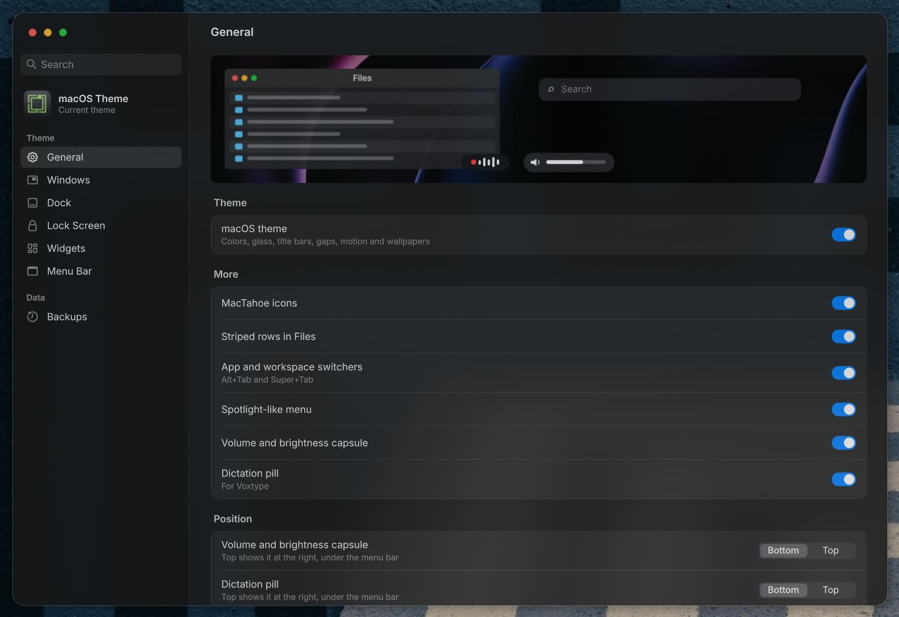

# macOS Theme Studio

Install, customize, back up and update the [macOS theme for Omarchy](../README.md), in a window shaped like macOS System Settings.



The macOS theme turns [Omarchy](https://omarchy.org) into a dark macOS look: frosted glass, title bars with traffic lights, a macOS dock, a lock screen, desktop widgets, a menu bar with Control Center, and more. Its installer, `install.sh`, does everything from the terminal. This app does the same without a terminal: a switch for each part of the theme, sliders for its settings, backups you can restore, and one button to update.

Made for Omarchy 4 and later. Open source, MIT.

## Contents

- [What it does](#what-it-does)
- [Install](#install)
- [Using it](#using-it)
- [What a change touches](#what-a-change-touches)
- [How it works](#how-it-works)
- [Building from source](#building-from-source)
- [Project layout](#project-layout)
- [Development](#development)
- [Design](#design)
- [Troubleshooting](#troubleshooting)
- [Credits and license](#credits-and-license)

## What it does

| Page | What's on it |
|---|---|
| **About** (the theme card at the top of the sidebar) | The app's version, the Omarchy versions it's made for, whether the theme is up to date with an **Update** button when it isn't, and links to both projects |
| **General** | The theme itself, the MacTahoe icons, striped rows in Files, the app and workspace switchers, the Spotlight-like menu, the volume and brightness capsule, and the dictation pill |
| **Windows** | How see-through the windows you aren't using are, the same for browsers and Electron apps (Claude, VS Code, Slack…), how strong the frosted blur behind them is, Reduce motion, the title bars and their traffic lights' size, and snapping windows to halves and corners |
| **Dock** | The macOS dock (magnification, window previews, Downloads and Trash), how far its icons grow and how big they are |
| **Lock Screen** | The macOS lock screen, and a **Show** button to see it without locking |
| **Widgets** | The desktop widgets: clock, calendar, weather and now playing |
| **Menu Bar** | The macOS menu bar: Inter, the app's name in bold, and Control Center; and every item on the bar, in Left, Center and Right, to show or hide with a switch and drag to rearrange (the clock too) |
| **Backups** | Back up now, where backups are kept, restore any backup, and export or import your setup |

- **Changes wait for Apply.** Flipping switches and moving sliders changes nothing until you press **Apply** in the toolbar at the top. Then every change goes to the installer in one call, so the theme reloads once. **Revert** throws the changes away.
- **Changes waiting are marked**: a blue dot by each row changed and not applied yet. "N changes" in the toolbar lists them in words, with Apply. Closing the window with changes waiting asks first (Apply, Don't Apply or Cancel), and Restore, Import and Update say in their question that they would drop them.
- **Every change is backed up first**, by the theme's installer, and can be restored from **Backups**.
- **Search** at the top of the sidebar finds pages and the settings on them as you type: "glass" finds General, "weather" finds Widgets. Ctrl+F focuses it; ↑ and ↓ move through the results, Return opens one, Esc clears it.
- **The keyboard does it all.** Tab moves between the sidebar and each control, with the blue ring macOS draws; ↑ and ↓ go through the sidebar's pages, Space or Return flips a switch or presses a button, the arrows move a slider (Page Up and Down, Home and End too) or pick a segment, and ↑ and ↓ on a menu bar item's handle move it, into the next group at either end. Ctrl+S applies. A question sheet holds the focus until it is answered: Esc cancels, and when the action would replace something, Cancel is the default. A control that can't be used says why under its row.
- **Updates.** When the app opens it asks GitHub whether the theme has new commits. If it has, the theme card in the sidebar and the About page say **Update available**, and **Update** brings the theme up to date.
- **It reopens on the page you last used**, and the window's title follows the page, as in macOS.

## Install

```bash
curl -fsSL https://raw.githubusercontent.com/tsubaie/omarchy-macos-theme/main/studio/get.sh | bash
```

This downloads the latest [release](https://github.com/tsubaie/omarchy-macos-theme/releases) to `~/.local/bin/omarchy-macos-studio` and puts it in the app launcher. Run it again to update. To remove it: `rm ~/.local/bin/omarchy-macos-studio ~/.local/share/applications/omarchy-macos-studio.desktop ~/.local/share/icons/hicolor/scalable/apps/omarchy-macos-studio.svg`.

### From source

The app needs Omarchy and Rust. Omarchy already has Qt 6, which the app uses.

```bash
sudo pacman -S rust
git clone https://github.com/tsubaie/omarchy-macos-theme.git
cd omarchy-macos-theme/studio
cargo build --release
./target/release/omarchy-macos-studio
```

To put it in the app launcher, with its name and icon (which the bar, the dock and the app switcher show for its window):

```bash
./install-desktop.sh                                  # it manages ~/.local/share/omarchy-macos-theme
./install-desktop.sh ..                               # or the theme in this checkout
./install-desktop.sh --remove                         # take it out again
```

The first build compiles CXX-Qt's C++ and takes a few minutes; later builds take seconds. The program is about 2 MB and uses about 70 MB of memory while open, nothing while closed.

On first run, the app shows a welcome page with a **Download** button (about 20 MB). It downloads the theme's newest release (or `main`, until the theme has releases) into `~/.local/share/omarchy-macos-theme`, the same place [Omarchy Sync](https://github.com/tsubaie/OmaSync) keeps it, so the two share one copy.

An Arch package (AUR) is planned.

## Using it

### Turning parts on and off

Each switch is one part ("piece") of the theme. Flip the ones you want, then press **Apply** in the toolbar at the top. While it works, the toolbar shows a spinner, what the installer or git says it is doing (the piece it is on, how much of a download has come) and, after a few seconds, how long it has taken, with **Stop** to end it. Once it is done, the switches show what is really installed and a green note says what was done, with **Undo**, which restores the backup the installer took just before. If the installer refuses something, its message appears in red at the top with what to do next and **Show Details** for all it said, and your changes stay marked so you can fix them and apply again.

Turning off **macOS theme** while it's your current Omarchy theme shows a **Switch to** row of your other themes: pick one, and Apply switches to it before the macOS theme goes.

### Removing the theme

**Remove macOS Theme…** at the bottom of About takes it all away in one step, after asking:

- **Remove** turns every piece off in one Apply, the MacTahoe icons too, and gives back what each one replaced: Omarchy's dock, bar, menu and lock screen, or your own. While the macOS theme is current, Omarchy switches first to the theme you had before it, which the question names. Your other changes since stay. **Undo** in the green note puts it all back but the icons, which backups don't hold; turn **MacTahoe icons** on again in General for those.
- **Go Back**, offered when there is a backup from before the theme, restores that backup instead: everything as it was that day, whole, so edits to `shell.json`, `looknfeel.lua` and `gtk.css` since go too.

Studio itself stays installed, so you can install the theme again from General.

A setting or piece the installed theme is too old for is shown dimmed, with "Update the theme to use this".

### Settings

| Setting | Range | The theme's default |
|---|---|---|
| Window glass | 0.75 (see-through) to 1 (solid), for the windows you aren't using; the one you are using is always solid. The menus, launcher, notifications and popups follow it | 0.85 |
| Browser and app glass | 0.5 to 1 | 1 (solid, since browser menus are hard to read on glass) |
| Frosted blur | 0 (off; see-through windows stay see-through, unblurred) to 20 | 10 |
| Reduce motion | on (fades instead of springs and slides, no genie, still weather) or off | off |
| Title bars | on or off | on |
| Traffic light size | 10 to 20 points | 14 |
| Snapping | on or off | on |
| Dock magnification | 1 (off) to 2 | 1.75 |
| Dock size | 32 to 80 points | 48 |
| Volume capsule and dictation pill | at the bottom, or at the top right under the menu bar | bottom |

Settings are kept when the theme is updated.

### Backups

The theme's installer backs up what it is about to change before every change, so any change can be undone:

- **Back Up Now** takes a backup by hand.
- Each backup is listed with when it was taken and what changed after it ("Added macOS dock", "Window glass 0.9"). **Restore** puts it back after asking, naming the files it replaces, and backs up your setup first, so a restore can be undone too.
- **Where they are** shows the folder, `~/.config/omarchy/macos-theme-backups`, with **Open**.
- The last 10 backups are kept, and the very first one for good. On a computer where the theme is new, that first one is "Before macOS theme": Omarchy as it was.
- **Before macOS theme** restores like any backup, and also removes the theme's MacTahoe icons, so the computer is as it was before the theme.
- Backups are small, a few hundred KB, because the theme's own wallpapers come back from the repository instead of being copied.

### Export and import

**Export…** saves your choices to one file: which pieces you use, your settings, your dock (its pinned apps) and widgets (their layout and screen), and wallpapers you added. **Import…** sets another computer up from that file. It re-applies the choices with the installer it runs in, rather than copying files, so an export fits a new install or a newer version of Omarchy and the theme. Pieces a newer version no longer has are skipped with a note. Import backs up first, and refuses any file that holds anything other than a profile and images.

### Updating the theme

Updates follow the theme's releases: tags named `vX.Y.Z`, not every commit on `main`. When a newer release is out, **Update available** shows. Press **Update**, and the confirmation lists what's new in it. After you confirm, the app moves the theme to that release and installs the pieces you use again, in one installer call that backs up first and reloads the theme once. The MacTahoe icons aren't reinstalled: they come from their own project, not from the theme.

If the theme folder has changes of its own that would be overwritten, the update stops with git's message and nothing is installed. A copy downloaded from `main` before releases began stays where it is until a release newer than it comes out; it is never moved back to an older one. Until the theme has its first release, updates follow `main` as before.

## What a change touches

The app never edits your files itself. The theme's installer does, and only these:

| File or folder | What for |
|---|---|
| `~/.config/omarchy/shell.json` | Omarchy's bar, dock and plugin settings, and the widgets' layout |
| `~/.config/hypr/looknfeel.lua` | One line that loads the theme's look |
| `~/.config/gtk-4.0/gtk.css` | Two imports from the current theme's folder: blur for GTK apps, and the striped rows in Files, both only while the theme is current |
| `~/.config/omarchy/themes/macos` | The theme itself |
| `~/.config/omarchy/plugins/` | The theme's plugins (`macos-theme.*`), and its clones of Omarchy's menu, lock and workspaces |
| `~/.config/omarchy/hooks/post-update.d/macos-theme-lock` | With the lock screen: brings Omarchy's new lock code into the theme's after each update |
| `~/.config/omarchy/macos-theme-backups` | The backups, and what the theme needs to undo itself |

Left alone: plugins and clones of your own, your keybindings file, your apps and their settings, your terminal font. The Omarchy plugins the theme stands in for (its dock, on-screen display, menu and lock) are turned off while the theme's are on, and turned back on when they go. A restore puts `shell.json`, `looknfeel.lua` and `gtk.css` back whole, so edits you made to them since the backup go too; the Restore question says so. Applying reloads Hyprland and may restart Omarchy's shell, so the bar and dock blink once; your windows and apps stay open.

The app keeps one small thing of its own: the last page you viewed (`~/.config/omarchy/macOS Theme Studio.conf`). Omarchy's logo for the About page is read from your Omarchy install and recolored in memory.

## How it works

```
┌────────────── QML (the window) ──────────────┐
│  Sidebar · pages · switches · sliders · Apply │
└──────────────────────┬────────────────────────┘
                       │ ThemeBackend (CXX-Qt object)
┌──────────────────────▼────────────────────────┐
│  Rust: checks every request, runs install.sh  │
│  and git on a worker thread, reports back     │
└──────────────────────┬────────────────────────┘
                       │
        install.sh in the theme folder ── changes your setup
        git ── checks for theme releases and moves to them
```

- **The installer is the single source of truth.** The app asks it what is installed (`install.sh --status --json`) and has it make every change (`--add`, `--remove`, `--set`, `--backup`, `--restore`, `--export`, `--import`). The app, the terminal and Omarchy Sync therefore always agree.
- **Nothing unchecked reaches the installer.** Piece names, setting keys and ranges, and backup ids are checked in Rust before any command runs, so the window can't pass the installer anything it wouldn't accept.
- **The window never stalls.** Every installer and git call runs on a worker thread, one at a time, and the result comes back to the window's thread. While one runs, the controls wait, the toolbar says what it is doing, and **Stop** ends it: each call runs in a process group of its own, so what it started stops too. Every git call has a time limit, and none asks for a password.
- **Rust and QML.** The window is QML (Qt Quick), compiled into the program; the logic is Rust, bridged with [CXX-Qt](https://github.com/KDAB/cxx-qt) 0.10. It links to the Qt 6 that Omarchy already has, so the program stays small.

## Building from source

Requirements:

- Rust 1.85 or later (`sudo pacman -S rust`; built and tested with 1.99)
- Qt 6 with Qt Quick, Qt Quick Dialogs and Qt SVG (Omarchy has them: `qt6-base`, `qt6-declarative`, `qt6-svg`; tested with 6.12)
- A C++ compiler (Omarchy has `clang` and `gcc`)

CXX-Qt finds Qt through `qmake6`. If your system names it differently, set `QMAKE`:

```bash
QMAKE=qmake6 cargo build --release
```

Release builds use thin link-time optimization so they rebuild quickly; packages use the `dist` profile for the smallest program (`cargo build --profile dist`). For the quickest rebuilds while working, use a debug build (`cargo build`, or `./dev.sh`).

To work against the theme in this checkout instead of the downloaded copy:

```bash
OMARCHY_MACOS_THEME_DIR=.. ./target/release/omarchy-macos-studio
```

Open a given page with `--page <id>`: `overview`, `general`, `windows`, `dock`, `lock`, `widgets`, `menubar` or `backups`.

## Project layout

```
src/
  main.rs        Starts Qt, the font, and loads the window
  theme.rs       ThemeBackend: the object QML talks to (properties and actions)
  install.rs     Everything that runs install.sh and git, with the checks and tests
qml/
  Main.qml       The window: sidebar, search, pages, toolbar, banners, dialogs
  SearchField.qml, MacSwitch.qml, MacSlider.qml, MacSegmented.qml, Group.qml,
  SettingRow.qml, FocusRing.qml, TrafficLights.qml, BarItems.qml
                 The macOS controls, and the menu bar's items to drag
  BarModel.js    The menu bar's Left, Center and Right groups
  Labels.js      Pieces and settings in the rows' words (changes, backups)
assets/
  icon.svg, icon-mono.svg, icon-omarchy.svg
                 The app icon in color, mono, and Omarchy's green (the one in use)
  make_icon.py, trace_mark.py, mark.txt
                 Regenerate the icon (see the script's header)
  icons/         The sidebar and search icons (Icons8)
icons8.json      The icon pack and ids, so new icons match
build.rs         The QML module and the files compiled in
dev.sh           Watch mode
```

## Development

### Watch mode

```bash
./dev.sh ..
```

Rebuilds and reopens the app on the same page whenever a file in `qml/`, `src/` or `assets/` is saved. A failed build leaves the last good app open, with the errors above it. Needs `inotify-tools`.

### Checks

```bash
cargo fmt
cargo clippy --all-targets -- -D warnings
cargo test
```

`../tests/run.sh` runs these and the theme's tests in one go. The Rust tests include a contract with the real `../install.sh`: the pieces, settings and ranges Studio sends are ones it takes, and Studio reads what it reports. `node tests/bar-model.test.js` tests the menu bar's Left, Center and Right groups, `node tests/labels.test.js` the backups' labels, and `QT_QPA_PLATFORM=offscreen /usr/lib/qt6/bin/qmltestrunner -input tests/qml` drives real presses, drags and releases on its rows: moving within and between groups, hiding and showing, dropping into an empty group, letting go over nothing, the page holding still under a drag and scrolling at its edges, and several drags in a row.

The Rust tests cover what can go wrong between the window and the installer: piece names, settings and their ranges, how changes combine into one installer call (a theme to switch to first included), refusing bad changes before anything runs, reading the installer's status and backups, backup ids, which pieces an update reinstalls, reading progress from git and the installer, Stop ending a command and what it started, keeping all a failed command said, and recoloring Omarchy's logo.

### Making a release

Releases are named for the day they're made: `2026.11.03`, or `2026.11.03.2` for a second one that day. From `main`, press **Run workflow** on the [tests workflow](https://github.com/tsubaie/omarchy-macos-theme/actions/workflows/tests.yml), or:

```bash
gh workflow run tests.yml --ref main
```

Once the tests pass, CI builds the program on Arch for x86_64 and on Arch Linux ARM for aarch64, with the release's name as its version (About shows it), tags the commit and publishes `omarchy-macos-studio-x86_64.tar.gz` and `omarchy-macos-studio-aarch64.tar.gz`, packed by `package.sh`; `get.sh` downloads the one for the machine. Run on another branch, the workflow builds both without publishing, to try a change to the builds. The latest release's name is at `https://api.github.com/repos/tsubaie/omarchy-macos-theme/releases/latest` (`tag_name`): a name other than the app's own means there is an update. A local build shows `Cargo.toml`'s version instead.

### The app icon

```bash
cd assets
python3 make_icon.py mark.txt omarchy > icon-omarchy.svg   # in use: graphite and Omarchy's green
python3 make_icon.py mark.txt mono > icon-mono.svg         # graphite and white
python3 make_icon.py mark.txt > icon.svg                   # lime on deep teal
```

## Design

The app follows Apple's [Human Interface Guidelines](https://developer.apple.com/design/human-interface-guidelines) for macOS, translated to Qt Quick:

- **Search at the top of the sidebar**, filtering it as people type, as System Settings does ([Search fields](https://developer.apple.com/design/human-interface-guidelines/search-fields)).
- **A full-height sidebar** with gray line symbols, section headings and a soft gray selection, as Finder draws it with the graphite accent ([Sidebars](https://developer.apple.com/design/human-interface-guidelines/sidebars)).
- **Switches in the accent blue at the small size** macOS uses in grouped rows, so rows keep one height ([Toggles](https://developer.apple.com/design/human-interface-guidelines/toggles)).
- **The window title follows the page, and the last page is restored** ([Settings](https://developer.apple.com/design/human-interface-guidelines/settings)).
- **macOS text sizes**: 13 pt body, 13 pt semibold headings ([Typography](https://developer.apple.com/design/human-interface-guidelines/typography)).
- **Color only where it means something**: the controls and the Apply button; everything else neutral ([Color](https://developer.apple.com/design/human-interface-guidelines/color)).
- **Screen-reader names and roles** for every switch, slider, button, page and question sheet (a dialog), errors and confirmations as alerts, a reason on a control that can't be used, and full keyboard use. Body text and buttons are colored for 4.5:1 contrast against what is behind them, worked out from their colors, not measured on screen ([Accessibility](https://developer.apple.com/design/human-interface-guidelines/accessibility)).
- **Traffic lights in the sidebar and a toolbar across the top**, as Apple's own apps draw their windows: the page's title on the left, the changes waiting and **Apply** on the right, and the top of the window to drag it by. The theme turns its title bar off for this app only.

## Troubleshooting

| What you see | Why, and what to do |
|---|---|
| "Pick the theme to switch to first" | The macOS theme is your current theme. Pick one in the **Switch to** row under it, then apply again. With an older theme, which lists none, run `omarchy theme set <another theme>` first. |
| "Another run of install.sh is changing the theme" | The installer is already running, from a terminal or another window. Wait for it to finish, then try again. |
| Download fails | The app clones from GitHub with git; check that git is installed and you are online. A download cut short leaves nothing half done; try again. |
| "Couldn't check for updates" | GitHub didn't answer within 30 seconds, or you're offline. Everything else works meanwhile; **Check Again** asks once more. |
| Update stops with a git message | The theme folder has changes of its own that can't be fast-forwarded. Commit or discard them in `~/.local/share/omarchy-macos-theme`, then update again. |
| Update is still offered after one failed | It downloaded the new version but couldn't install it; the error says why. **Update** installs it again once that is fixed. |
| Backups is empty | The theme is older than its backups feature; updating it brings backups. |
| The window doesn't look like the screenshots | The macOS theme isn't the current Omarchy theme, or the Inter font is missing (`sudo pacman -S inter-font`). |
| The build can't find Qt | Set `QMAKE=qmake6` (or the path to your `qmake`) before `cargo build`. |

## Credits and license

- **[Omarchy](https://omarchy.org)**, the desktop this is made for. Its logo on the About page is read from your Omarchy install, recolored in Omarchy's green, and isn't shipped with this app. The app icon is a redrawing of Omarchy's mark.
- **[CXX-Qt](https://github.com/KDAB/cxx-qt)** by KDAB, for Rust and Qt together.
- **Icons by [Icons8](https://icons8.com)**: the SF Symbols style set for the sidebar and search field.
- **[Inter](https://rsms.me/inter/)**, the typeface.

Not affiliated with Apple or Omarchy. macOS is a trademark of Apple Inc.

MIT license; see [LICENSE](LICENSE).
